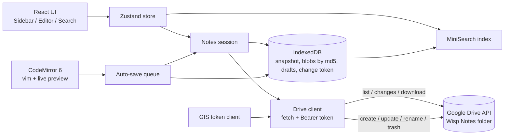

# Implementation Plan - wisp-notes (v2: Google Drive storage)

## Problem Statement

Wisp Notes v1 (implemented) stores Markdown notes in a private GitHub repo. Notes will contain many
screenshots, which bloat a Git repo permanently. v2 replaces GitHub with Google Drive: notes live in a
`Wisp Notes` folder in the user's Drive, the user signs in with Google, and on startup (and when returning
to the tab) the app loads the latest content from Drive. Editor, folder tree, icons, auto-save, offline
cache and search stay as in v1.

Out of scope for now: hosting / phone access (runs on localhost), displaying or pasting images, Notion
migration tooling beyond a generic file import, long-term revision retention ("keep forever").

## Requirements

- Storage: Google Drive only, via the Drive REST API v3 called directly from the browser (no own backend).
- Auth: "Sign in with Google" using Google Identity Services (GIS) token model; scope
  `https://www.googleapis.com/auth/drive.file` only (the app sees only files it created or imported).
- OAuth client ID supplied via `VITE_GOOGLE_CLIENT_ID` in `.env.local` (not committed; not a secret).
- GitHub support is removed completely (code, settings, Octokit dependency, tests).
- Structure unchanged for the user: Drive folders = categories, `.md` files = notes, `_meta.json` in a
  folder holds its Lucide icon (`{ "icon": "book-open" }`).
- Latest content: on startup and on tab focus/visibility, fetch Drive changes and download only files whose
  content changed. Every device opens the current version.
- Auto-save: unchanged timing (3 s idle, 45 s max while typing); all dirty drafts saved in one batch
  (parallel per-file uploads; Drive has no multi-file transaction).
- Conflicts: before overwriting a file, verify it is unchanged since it was loaded; otherwise save ours as
  `Note (conflict YYYY-MM-DD).md` and notify (same UX as v1).
- Import: "Import files" action uploads a local folder/files (keeping relative structure) into a chosen
  folder — needed because `drive.file` cannot see files added to Drive outside the app (e.g. Notion export).
- Offline reading, drafts in IndexedDB, search, vim, live preview: unchanged.
- Mainstream libraries, exact pinned versions, strict CSP (allowing only the Google domains GIS needs).

## Background (research findings)

- `drive.file` is Google's recommended non-sensitive Drive scope: no restricted-scope verification; access is
  limited to files created by (or opened with) this OAuth client. Files stay in the user's Drive regardless;
  if the Cloud project / client is deleted and recreated, the app loses visibility (re-import needed).
- GIS token model (`google.accounts.oauth2.initTokenClient`): browser-only, short-lived access tokens
  (~1 h), no refresh tokens. A new token requires `requestAccessToken` from a user click (popup; it
  closes immediately when consent was already given). Loaded from `https://accounts.google.com/gsi/client`.
- GIS CSP needs: `script-src https://accounts.google.com/gsi/client`, `frame-src https://accounts.google.com/gsi/`,
  `connect-src https://accounts.google.com/gsi/`, `style-src https://accounts.google.com/gsi/style`.
- Drive API supports CORS with `Authorization: Bearer`. Relevant endpoints:
  - `files.list` (`q`, `fields=id,name,mimeType,parents,md5Checksum,version,modifiedTime,trashed`, paginated)
    → one listing of all app-visible files; paths are rebuilt from the `parents` chain.
  - `changes.getStartPageToken` / `changes.list` → incremental deltas since the last sync (fast startup).
  - `files.get?alt=media` (download), multipart upload `upload/drive/v3/files` (create),
    `PATCH upload/drive/v3/files/{id}?uploadType=media` (update content), `files.update` (rename, move,
    `trashed: true`).
- `md5Checksum` is a content hash → replaces Git blob SHA as the IndexedDB blob cache key.
  `version` increases on every change → used for conflict checks.
- Drive v3 has no atomic multi-file write and no conditional (If-Match) update: conflict check is
  "read metadata → compare → write" (small race window, acceptable for a single user).
- Drive has real folders: empty folders exist without a placeholder; `_meta.json` is only for icons.
  Folder rename = one metadata update (cheaper than Git). Delete = move to trash (recoverable 30 days).
- Revisions: Drive keeps past versions of a file for ~30 days or 100 versions; current files are kept
  indefinitely. Accepted trade-off vs. Git's permanent history.
- Storage counts against the user's Google quota (15 GB free, shared with Gmail/Photos).

## Proposed Solution

### Stack changes

- Remove: `@octokit/rest`, GitHub client/errors, `FakeGitHub`.
- Add: GIS script (loaded at runtime, typed by a small local `.d.ts`), thin `fetch`-based Drive client
  (no `gapi`; keeps bundle small and testable with MSW). No new npm runtime dependencies.

### Architecture

### Data model

- Snapshot: `{ rootId, changeToken, entries: { id, path, kind: 'file' | 'folder', md5?, version }[] }`.
  Paths are relative to the `Wisp Notes` root folder; the UI keeps working with paths, the session maps
  path ↔ Drive file ID.
- Root folder: created on first sign-in (`Wisp Notes` in My Drive, marked with
  `appProperties.wispRoot = "1"`); found again on other devices by that property.

### Data flow

1. Startup: render cached snapshot + drafts → ensure token → `changes.list` since stored token (fallback to
   full `files.list` if the token is missing/expired) → update snapshot → download only files whose `md5`
   isn't cached. Repeat on tab focus/visibility.
2. Every edit is written to a draft in IndexedDB immediately.
3. Auto-save: for each dirty draft, re-read the file's metadata; if `version`/`md5` still matches the draft's
   base → upload; else write a conflict copy. Uploads run in parallel (limited concurrency); failures keep
   the remaining drafts and retry with backoff.
4. Token expiry: GIS needs a user click to issue a new token, so on expiry (or 401) a "Continue as …" banner
   appears; drafts stay safe locally and are saved right after continuing.

### Security notes

- Access token (≤1 h) kept in localStorage until it expires, so reloads stay signed in; no refresh token or other
  long-lived credential is stored. Sign-out revokes the token and clears local data.
- `drive.file` limits blast radius to the app's own files.
- CSP allows only `'self'`, `https://www.googleapis.com` and the GIS endpoints listed above.

## Task Breakdown

### Task 1: Google sign-in

- Objective: Sign in/out with Google and obtain a `drive.file` access token.
- Guidance: `src/drive/auth.ts` (lazy-load GIS script, token client, click-to-renew, expiry tracking,
  `onTokenChange`); replace Settings token form with Sign in / Sign out + signed-in account; read
  `VITE_GOOGLE_CLIENT_ID` (clear error if missing); update CSP for GIS + `www.googleapis.com`; keep editor
  preferences in Settings.
- Tests: auth wrapper with a stubbed `window.google` (grant, deny, cancel, expiry); settings UI states.
- Demo: Click "Sign in with Google" → "Signed in".

### Task 2: Drive client & fake Drive

- Objective: Typed Drive operations used by the app.
- Guidance: `src/drive/client.ts` (`ensureRoot`, `listAll`, `getStartPageToken`, `listChanges`, `download`,
  `createFile`, `createFolder`, `updateContent`, `rename`, `move`, `trash`, `getMetadata`), UTF-8 safe,
  normalized errors (`auth`, `forbidden`, `not-found`, `rate-limit`, `network`). `src/test/fakeDrive.ts`
  in-memory Drive (files, folders, md5, versions, changes feed, offline, injected failures) shared by MSW
  and Playwright.
- Tests: MSW for each operation, pagination, error mapping, change feed.
- Demo: Root folder created in Drive on first sign-in.

### Task 3: Snapshot, cache & sync

- Objective: Instant startup from cache, then latest content from Drive.
- Guidance: Build path tree from `parents`; snapshot + change token in IndexedDB (schema bump, blobs keyed
  by `md5`); incremental sync via `changes.list` with full-list fallback; refresh on focus/visibility;
  only changed files downloaded. Adapt `buildTree` (real folders, empty folders shown).
- Tests: path building (nesting, moved/renamed/trashed via changes), only-changed-downloaded, offline cache.
- Demo: Edit a note in another browser profile → switch back → updated content appears.

### Task 4: Save engine & auto-save

- Objective: Replace the Git commit engine with per-file Drive writes.
- Guidance: `src/repo/save.ts`: batch of drafts → per-file check-then-write, conflict copies, limited
  concurrency, partial-failure handling; new files created on first save. Keep `AutoSaver`, drafts,
  Ctrl/Cmd+S, `:w`, status indicator, `beforeunload`; expired token or 401 → "Continue as …" banner.
- Tests: single/multi-file save, conflict copy, partial failure + retry, token expiry mid-save.
- Demo: Type, pause → file updated in Drive.

### Task 5: Note & folder operations

- Objective: Same operations as v1 on Drive.
- Guidance: Rewrite `ops.ts` builders as Drive operations: create note/folder, rename (single metadata
  update; folder rename no longer touches children), delete = trash (confirm dialog mentions Drive trash),
  icon = write `_meta.json`. Optimistic UI with rollback kept.
- Tests: builder/unit tests per operation; existing sidebar/context-menu tests adapted.
- Demo: Create/rename/delete notes and folders; changes visible in Drive.

### Task 6: Import files

- Objective: Bring existing notes (e.g. Notion export) into the app-visible folder.
- Guidance: "Import files…" in the folder context menu and empty state: `<input type="file" multiple
webkitdirectory>` (plus a files-only variant); recreate relative folder structure, upload all files
  (`.md` and images; images stored but not displayed yet), skip hidden files, progress + summary, name
  clashes get a numeric suffix.
- Tests: structure mapping, clash handling, progress/summary UI.
- Demo: Import a folder of Markdown files with screenshots; notes appear in the sidebar.

### Task 7: Remove GitHub, docs & E2E

- Objective: Clean codebase, docs and full-flow verification.
- Guidance: Delete GitHub code/deps/tests; update README (Google Cloud setup, `.env.local`), ARCHITECTURE.md;
  Playwright E2E with mocked GIS script and fake Drive: sign in → browse → edit → auto-save → rename →
  search → import, plus offline reload.
- Tests: E2E at desktop and mobile viewports; full unit suite, lint, typecheck, build.
- Demo: Complete app working against the fake Drive; real sign-in works once a client ID is configured.

## Future (not in scope)

Hosting + phone access (register the hosted origin in Google Cloud), image paste/display, backlinks,
revision "keep forever", installable PWA.
