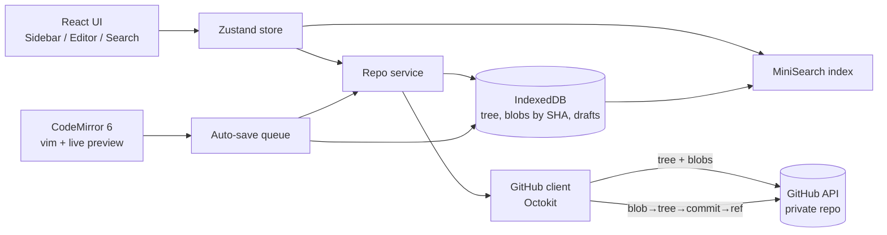

# Implementation Plan - wisp-notes

## Problem Statement
A minimal, personal Notion replacement ("Wisp Notes") for Markdown notes stored in a private GitHub repo. It is browsable as folders with icons, editable with vim motions in an Obsidian-style live-preview editor, auto-saved to GitHub, and searchable. Out of scope for now: hosting, Notion migration (user will migrate manually later).

## Requirements
- Storage: private GitHub repo only; the browser talks to the GitHub API directly (no own backend/database).
- Auth: GitHub fine-grained Personal Access Token (scoped to the notes repo, Contents read/write), entered once per device.
- Structure: folders = categories, `.md` files = notes. Per-folder Lucide icon stored in `_meta.json` in that folder, e.g. `{ "icon": "book-open" }`.
- Editor: CodeMirror 6 with live preview (Markdown syntax hidden except on the active line/selection) + full vim motions.
- Auto-save: debounced (~3s idle) with a max interval (~45s) while typing; pending changes batched into a single commit.
- v1 scope: folder tree, open/edit notes, create/rename/delete notes & folders, folder icons, full-text search.
- Performance and AI-maintainability prioritized; mainstream libraries only. User will not edit code by hand (AI maintains it).
- App name: wisp-notes (package/repo name), "Wisp Notes" (UI title).

## Background (research findings)
- Vim: `@replit/codemirror-vim` is mature and production-proven. ProseMirror/Milkdown vim add-ons (prose-motions, tiptap-vim, vimirror) are young/partial — hence CodeMirror over Milkdown.
- Live preview: Obsidian's approach = CodeMirror 6 decorations hiding syntax. Existing libs (`codemirror-live-markdown`, `atomic-editor`) are young; write a small custom extension on `@codemirror/lang-markdown`'s syntax tree, borrowing ideas from those libs.
- Reads: `GET /repos/{o}/{r}/git/trees/{branch}?recursive=1` returns all paths + blob SHAs in one request. Blob SHAs are content-addressed, so cached content is never stale.
- Writes: Git Data API (create blobs → create tree with base_tree → create commit → update ref with force=false) enables atomic multi-file commits (folder rename, batched auto-save). Non-forced ref update fails if remote moved → conflict detection.
- Git doesn't track empty folders; every app-created folder gets a `_meta.json`, which doubles as a placeholder.
- Rate limit: 5,000 requests/hour with a token — ample for single user.
- Base64 content must be decoded via `TextDecoder` (UTF-8) to handle emoji/accents.

## Proposed Solution

### Stack
- Vite + React + TypeScript (strict) SPA (no SSR needed)
- Tailwind CSS; `lucide-react` (dynamic/lazy icon loading)
- Zustand (state), React Router (deep links `/n/<path>`)
- CodeMirror 6: `@codemirror/lang-markdown`, `@replit/codemirror-vim`, custom live-preview extension
- `@octokit/rest` (GitHub API)
- `idb` (IndexedDB: tree, blobs-by-SHA, drafts)
- MiniSearch (full-text search, fuzzy + prefix)
- Testing: Vitest + Testing Library + MSW (GitHub API mocks) + fake-indexeddb; Playwright for E2E
- Use exact/pinned dependency versions.

### Architecture

### Data flow
1. Startup: render cached tree instantly → fetch current tree → diff SHAs → fetch only changed blobs.
2. Every edit is written immediately to a draft in IndexedDB (no loss on tab close).
3. Auto-save collects all dirty drafts → one commit with a change set.
4. On ref conflict: refetch head; if the edited file's remote blob SHA is unchanged since our base, recreate commit on new head; otherwise save ours as `Note (conflict YYYY-MM-DD).md` and notify the user.

### Security notes
- PAT stored in the browser (localStorage/IndexedDB) → XSS is the main risk: strict Content Security Policy, no third-party scripts, no rendering of untrusted HTML.
- Recommend fine-grained PAT limited to the single notes repo with Contents read/write only.

## Task Breakdown

### Task 1: Project scaffold & app shell
- Objective: Running React/TS app named wisp-notes with layout and test tooling.
- Guidance: Vite React-TS template, Tailwind, ESLint + Prettier, Vitest + Testing Library, Playwright. Layout: collapsible sidebar, main pane, top bar with "Wisp Notes" title. Strict TS.
- Tests: Shell render test; Playwright smoke test.
- Demo: `npm run dev` shows the empty layout; `npm test` passes.

### Task 2: Settings & GitHub connection
- Objective: Enter PAT + owner/repo/branch, validate against GitHub, persist.
- Guidance: `src/github/client.ts` Octokit wrapper; settings screen; validate via `GET /repos/{owner}/{repo}`; persist locally; clear errors for bad token, insufficient scope, missing repo. Add strict CSP meta/header.
- Tests: MSW for 200/401/404; form behavior tests.
- Demo: Enter token → "Connected to owner/notes".

### Task 3: Folder tree in sidebar with icons
- Objective: Show the real repo structure.
- Guidance: Fetch recursive tree; pure `buildTree(entries)` → nested folders, only `.md` files shown, folders first then alphabetical. Read each folder's `_meta.json` and render the Lucide icon via dynamic icon component; fallback `Folder` icon. Expand/collapse folders.
- Tests: Unit tests for `buildTree` (nesting, sorting, ignored files, missing meta); sidebar component test.
- Demo: Sidebar shows the repo's folders with icons.

### Task 4: Open a note (read-only)
- Objective: Clicking a note shows its content.
- Guidance: Route `/n/<path>`; fetch blob by SHA; decode base64 as UTF-8 with `TextDecoder`; display in read-only CodeMirror with Markdown highlighting; loading and error states.
- Tests: Decode unit test (emoji/accents); click-to-open test.
- Demo: Clicking notes shows content; URL is bookmarkable/reloadable.

### Task 5: IndexedDB cache & instant startup
- Objective: Instant reloads and offline reading.
- Guidance: `src/cache/` with stores `tree`, `blobs` (keyed by SHA), `drafts`. Startup shows cache first, then revalidates and fetches only changed blobs. Offline indicator.
- Tests: Cache behavior with fake-indexeddb; only-changed-blobs-refetched test.
- Demo: Reload is instant; with network off, previously opened notes still display.

### Task 6: Commit engine & manual save
- Objective: Edit a note and save it to GitHub as a commit.
- Guidance: `commitChanges(changes: {path, content: string | null}[], message)` via Git Data API (blobs → tree with base_tree → commit → updateRef force=false; null content = delete). Conflict handling as described in Data flow step 4. Make the editor editable; Ctrl/Cmd+S saves.
- Tests: MSW for single commit, multi-file commit, delete, conflict → rebase retry, conflict → conflict copy.
- Demo: Edit, Ctrl+S, the commit appears on GitHub.

### Task 7: Auto-save
- Objective: Hands-free saving.
- Guidance: Write drafts to IndexedDB on every change; commit after 3s idle or max 45s while typing; batch all dirty drafts into one commit. Status indicator: Saved / Unsaved / Saving / Offline / Error. Retry with exponential backoff when offline; `beforeunload` warning if unsaved. Ctrl+S = save now. Restore and save pending drafts on startup.
- Tests: Fake timers for debounce/max-interval, batching, retries, draft persistence across reload.
- Demo: Type, pause → commit appears. Close tab mid-edit, reopen → draft restored and saved.

### Task 8: Vim mode
- Objective: Full vim motions in the editor.
- Guidance: Add `@replit/codemirror-vim`; NORMAL/INSERT/VISUAL mode indicator in status bar; map `:w` to save now; persisted on/off setting (default on) for mobile.
- Tests: Mode switching, `:w` triggers save, toggle persistence.
- Demo: Edit with hjkl, ciw, dd, visual mode; save with `:w`.

### Task 9: Live preview extension
- Objective: Near-WYSIWYG editing feel.
- Guidance: Custom CodeMirror ViewPlugin on the Markdown syntax tree: hide markers (`#`, `**`, `_`, `` ` ``, link syntax) except on the active line/selection; style headings, bold, italic, inline code, blockquotes, lists; render `- [ ]` / `- [x]` as clickable checkbox widgets that toggle the source text. Process only visible ranges for performance. Setting to toggle live preview vs raw Markdown. Verify vim motions behave correctly over hidden ranges.
- Tests: Decoration ranges for given doc + cursor positions; checkbox toggles source.
- Demo: Headings/bold render; syntax appears only on the current line; checkboxes work.

### Task 10: Note & folder operations
- Objective: Manage notes without touching GitHub directly.
- Guidance: Context menu + buttons for new note, new folder, rename, delete. New folder creates `_meta.json`. Folder rename/delete = one multi-file commit. Optimistic UI with rollback on failure. Confirm before delete.
- Tests: Unit tests for change-set builders per operation; context menu component tests.
- Demo: Create/rename/delete notes and folders; each action = one commit.

### Task 11: Folder icon picker
- Objective: Set or change a folder's icon.
- Guidance: Searchable picker over Lucide icon names, lazy-loaded so it doesn't affect initial bundle; saving writes `_meta.json` via commit engine.
- Tests: Picker search/filter; meta file write.
- Demo: Pick an icon for "Work"; it updates in the sidebar and the repo.

### Task 12: Full-text search & quick open
- Objective: Find any note fast.
- Guidance: Background-prefetch all `.md` blobs into cache with limited concurrency; build a MiniSearch index over title, path, content; update the index incrementally on save. Ctrl/Cmd+K quick-open palette searching titles and content, with match highlighting and full keyboard navigation. Works offline from cache.
- Tests: Index build/update, ranking (title > content), keyboard navigation.
- Demo: Ctrl+K, type a word, jump to the note with the match highlighted.

### Task 13: Mobile layout, polish & E2E
- Objective: Usable on a phone; whole flow verified.
- Guidance: Responsive layout (sidebar becomes a drawer on small screens), clear error messages, empty state for a new repo. Short `ARCHITECTURE.md` describing modules and data flow for future AI maintenance (user may opt out). Playwright E2E with mocked GitHub API: connect → browse → edit → auto-save → rename → search.
- Tests: Full E2E flow at desktop and mobile viewports.
- Demo: Complete app working on desktop and a phone-sized viewport.

## Future (not in scope)
Installable PWA with offline editing, hosting, image attachments, backlinks, Notion import helper.
