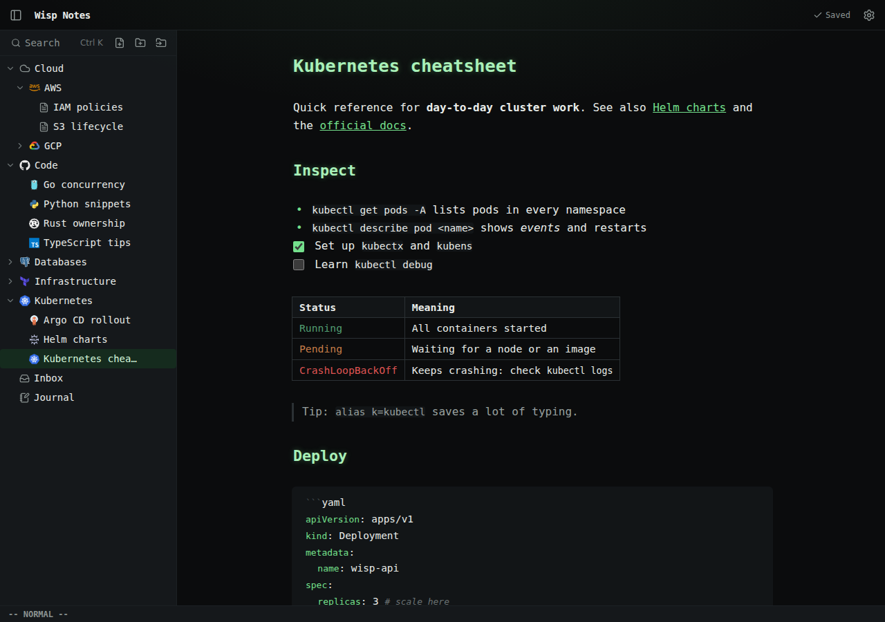

# Wisp Notes



Minimal personal notes app: Markdown notes in your own Google Drive, folder tree with icons, CodeMirror editor
with vim motions and live preview, auto-save, full-text search, offline reading.

There is no server and no account with anyone but Google. The app is a static website that runs in your
browser and talks directly to the Google Drive API. Each person who runs it creates their own (free) Google
Cloud OAuth client, so nobody else's app ever gets access to your notes.

## Quick start

Requirements: [Node.js](https://nodejs.org) 22.12 or newer (with npm), a Google account, and a browser.

```sh
git clone https://github.com/boris-yakimov/wisp-notes.git
cd wisp-notes
npm ci
```

1. Do the one-time [Google Cloud setup](#google-cloud-setup-one-time) below to get a client ID.
2. Create `.env.local` in the project root (it's gitignored) with your client ID:
   ```sh
   VITE_GOOGLE_CLIENT_ID=1234567890-abc123.apps.googleusercontent.com
   ```
3. Start the app and open http://localhost:5173:
   ```sh
   npm run dev
   ```
4. Click **Sign in with Google**. The app creates a **Wisp Notes** folder in your Drive and you can start writing.

## Using it

- **Where notes live**: Markdown files in the **Wisp Notes** folder in your Drive. Folders are categories. You can
  rename the folder or move it anywhere in My Drive; Settings shows where it is and links to it.
- **Permissions**: the app uses the `drive.file` permission, so it only sees files it created or imported, never
  the rest of your Drive. Use **Import folder** (sidebar header or a folder's menu), or **Import folder contents as sub-notes** on a note, to bring in existing Markdown
  files, such as a Notion export.
- **Organizing**: drag notes and folders onto a folder in the sidebar to nest them (or use **Move to…** in their
  menu). To reorder, drag an item to the top or bottom edge of another row (a line shows where it lands), or use
  **Move up** / **Move down** in its menu or `Alt+↑` / `Alt+↓`. The order is saved in Drive, so every device sees it.
- **Sub-notes**, like Notion pages: use **+** on a note row (or **New sub-note** in its menu), or drag a note onto
  another note. Sub-notes of `Plan.md` live in a `Plan/` folder next to it, the same layout as a Notion export, so
  imported Notion pages show up nested. A note with sub-notes lists them as links in a strip above its text.
- **Icons**: **Change icon** in a folder's or note's menu, then pick one, switch to **Logos** for colorful logos
  (AWS, Google Cloud, Kubernetes, Docker, Terraform, …), or **Upload image…** your own.
  **Auto-assign icons** on a folder guesses icons from names (a tool's logo where there is one, e.g. Docker,
  Kubernetes, AWS) for everything inside that has none yet, shows them, and saves after you confirm.
- **Saving**: edits are stored on the device immediately and saved to Drive once a minute, on `:w` / `Ctrl/Cmd+S`,
  before renames/moves/deletes, and when you close the tab.
- **Sidebar width**: drag the sidebar's right edge to make it wider or narrower (double-click it to reset); the
  width is remembered on this device.
- **Shortcuts**: `Ctrl/Cmd+K` search, `Ctrl/Cmd+S` or `:w` save now, `Ctrl/Cmd+E` mark the selection as code, `Ctrl/Cmd+click` a link to open it (links to
  other notes open in the app, websites in a new tab).
- **Text color**: select text (mouse, or vim visual mode) and pick a color (Red, Orange, Yellow, Green, Blue, Purple, Gray) or **Clear** in the small
  toolbar that appears. It's saved as `<span style="color: green">…</span>`, which other Markdown apps show too.
- **Code**: to keep text exactly as written (e.g. `argv[0]`), select it and choose **Code** in the same toolbar
  (or press `Ctrl/Cmd+E`; again inside the code to undo it), or **Code block** to put it on its own lines.
  Brackets that aren't links, like `argv[argc]`, already show as written.
- **Tables**: Markdown tables show as a grid; put the cursor in one (click, arrow keys or vim `j`/`k`) to edit its
  Markdown. `Ctrl/Cmd+click` links inside a table to open them. Wide tables scroll sideways.
- **Images**: paste an image or screenshot (`Ctrl/Cmd+V`, or `Ctrl/Cmd+Shift+V`, which also works in vim normal mode)
  into a note: it appears right away and is saved to Drive
  next to the note (`Plan.md` → `Plan/Pasted image ….png`). `` links to images in your notes folder
  (e.g. from a Notion export) show the image in the note too. `Ctrl/Cmd+click` a link to a PDF or other file to open it in a new tab.
- **Settings**: vim mode, live preview, and the theme (System/Light/Dark/Synthwave/Terminal).
- **Offline**: notes you've opened stay readable offline; edits are saved when you're back online.

## Google Cloud setup (one time)

The app needs its own OAuth client ID so Google can show the sign-in screen and know which website may access
your Drive. It's free; enabling the Drive API doesn't require billing.

1. **Create a project**: open https://console.cloud.google.com, sign in with the Google account whose Drive should
   hold the notes, then project picker → **New project** → name `Wisp Notes` → **Create**, and select it.
2. **Enable the Drive API**: **APIs & Services → Library** → search "Google Drive API" → **Enable**.
3. **Consent screen** (**Google Auth Platform** / **OAuth consent screen**) → **Get started**:
   - App information: name `Wisp Notes`, your email as support email.
   - Audience: **External**.
   - Contact information: your email → accept the policy → **Create**.
4. **Test user**: **Audience → Test users → Add users** → your Gmail address. Leave the publishing status on
   **Testing** (only listed test users can sign in).
5. **Scope**: **Data Access → Add or remove scopes** → select `.../auth/drive.file` ("See, edit, create, and
   delete only the specific Google Drive files you use with this app") → **Update** → **Save**.
6. **Client ID**: **Clients → Create client** → type **Web application**, name `Wisp Notes local`.
   - **Authorized JavaScript origins**: `http://localhost:5173` (dev) and `http://localhost:4173` (preview).
   - **Authorized redirect URIs**: leave empty (the sign-in popup doesn't use them).
   - **Create** and copy the Client ID (ends in `.apps.googleusercontent.com`).
7. Put it in `.env.local` as shown in [Quick start](#quick-start) and restart `npm run dev`.

Good to know:

- Google may warn "Google hasn't verified this app" while the app is in Testing. Choose **Continue**; it's your
  own app. To let other people use your copy, add them as test users (up to 100).
- **Keep the project.** With `drive.file`, Google ties access to this client. If the project is deleted, your notes
  stay in Drive but the app can't see them until you import them again.
- Google issues sign-in tokens for about an hour and requires a click to renew them. When yours expires, a
  "Continue as …" banner appears; edits are kept on the device and saved after you continue.
- The client ID is not a secret (it ends up in the built JavaScript). What protects it is the list of authorized
  origins. There is no client secret; don't create one.

## Commands

```sh
npm run dev        # dev server at http://localhost:5173
npm run build      # type-check + static production build in dist/
npm run preview    # serve the build at http://localhost:4173
npm test           # unit/integration tests (Vitest)
npm run e2e        # end-to-end tests (Playwright; first run: npx playwright install chromium)
npm run lint       # ESLint
npm run typecheck  # TypeScript
npm run format     # Prettier
```

The tests use an in-memory fake of Google Drive and Google sign-in, so they don't need a client ID, a network
connection or a Google account.

## Hosting it

`npm run build` produces a static site in `dist/` that any static host can serve (GitHub Pages, Netlify,
Cloudflare Pages, nginx, …):

1. Build with your client ID set (`.env.local`, or `VITE_GOOGLE_CLIENT_ID=… npm run build`).
2. Serve it over **HTTPS**, and make unknown paths fall back to `index.html` (notes have URLs like
   `/n/Work/Plan.md`). The app must be served from the domain root, not a sub-path.
3. Add the site's URL (e.g. `https://notes.example.com`) under **Authorized JavaScript origins** of your OAuth
   client.

The production build includes a strict Content Security Policy: only the app's own scripts and Google's sign-in
library may run, and it only connects to Google.

## Troubleshooting

- **"No Google client ID is configured"**: `.env.local` is missing or misnamed, or the dev server wasn't restarted.
- **Sign-in popup shows `Error 400: origin_mismatch`**: the URL in the address bar (including port) isn't in
  **Authorized JavaScript origins**. Changes there can take a few minutes to apply.
- **`Error 403: access_denied`**: your Google account isn't listed under **Audience → Test users**.
- **"Google Drive access was not granted"**: on the consent screen, the Drive checkbox was left unticked. Sign in
  again and allow it.
- **Notes added to Drive directly don't appear**: expected with `drive.file`. Use **Import folder** instead.
- **`vite: command not found`**: run `npm ci` first.

## How it works

See [ARCHITECTURE.md](ARCHITECTURE.md) for the design, data flow, security model and testing setup.

## License

Copyright © 2026 Boris Yakimov.

Wisp Notes is free software: you can redistribute it and/or modify it under the terms of the GNU General Public
License as published by the Free Software Foundation, either version 3 of the License, or (at your option) any later
version. It is distributed in the hope that it will be useful, but WITHOUT ANY WARRANTY. See [LICENSE](LICENSE) for
the full text.
